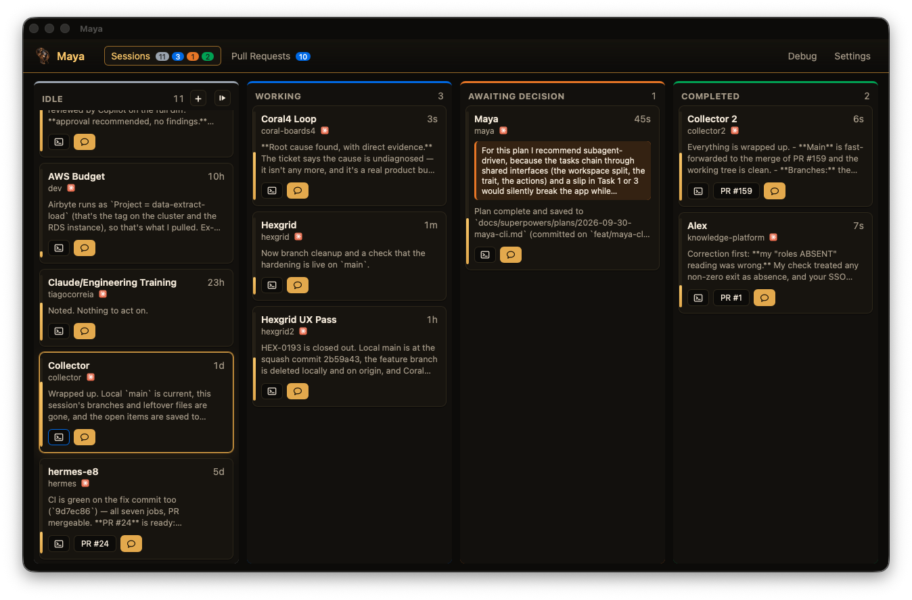

<p align="center">
  
</p>

<h1 align="center">Maya</h1>

<p align="center">Manage All Your Agents</p>

Your coding agents, on one board. Maya tells you when a session needs you
and lets you answer it from the board, or by voice. You do not have to find
the right terminal first.



## What it does

- Shows Claude Code, Codex, Antigravity, Grok Build, Kiro CLI and OpenCode sessions on one board as cards in a Kanban-like board
  - Each session card lands in a column: Idle, Working, Awaiting Decision or Completed
- Lets you reply, answer questions, and run slash commands and `!` shell lines from the card
- Stops a session that is working with a Stop button, which sends it the same Esc you would press in its terminal
- Answers a question from a menu like the agent's own: pick an option, write your own words with "Type something", or pick "Chat about this" to talk it over first
- Starts new sessions and resumes old ones
- After a restart, offers to resume every session that was running, on this machine and on the paired ones, each in its own folder and terminal: from the Sessions tab, or by voice ("Maya, resume my sessions")
- Shows what a session's terminal shows: the conversation, each command's output, edit diffs, how long it has been working, and its model, folder and branch
  - As a chat or in a terminal look, like the agent's own terminal (Settings → Sessions, or the `>_` button on the session)
- Tells you when a session needs you
  - Using built-in notifications, and/or a voice and/or a Dock badge
  - Keeps quiet under a Focus mode, or when you mute her from the top bar
- Lists the pull requests that ask for your review and the ones assigned to you, filtered by state and repository, with a dot for the review (green approved, blue commented, red changes requested): yours on review requests, the reviewers' on PRs assigned to you; reviews them in one click, and tells you when a PR assigned to you is approved or needs changes
- Does what you tell her by voice, through the agent you choose: "Maya, tell <session> to do <thing>"
- Resumes old sessions of any of them, and reviews pull requests with the agent you chose, on a prompt you can edit in Settings
- Shows the sessions of all your machines on one board.
- Comes in a dark theme (the default) and a light one: Settings › General › Theme
- Lets you choose which Enter combinations send a message and which make a new line, several for each: Settings › Keyboard (Enter sends by default)
- Runs headless over SSH with the `maya` command.
- Comes as an Android app too: a main Maya in your pocket, or a phone that joins your computer's Maya, shows every session, notifies you when one needs you and, joined to a computer, takes voice commands.

## Install

Run the commands below, or download Maya manually from the
[latest release](https://github.com/dosaki/maya/releases/latest).

Requirements:

- One of [Claude Code](https://claude.com/claude-code), [Codex](https://github.com/openai/codex), Antigravity, Grok Build, [Kiro CLI](https://kiro.dev/cli) or [OpenCode](https://opencode.ai), installed and, if applicable, signed in. Maya asks which one powers her on the first start; the others show on the board when they are installed.
- Pull requests: turn on GitHub or GitLab in Settings → Git and give it a token (or the name of a variable that holds one).
- macOS on Apple Silicon or Intel (macOS 14 or later for voice).
- Windows 10 or 11, 64-bit, with [Git for Windows](https://git-scm.com/download/win).
- Ubuntu 24.04 or later with GNOME, x86_64 or arm64. Other distributions
  with glibc 2.39 or later can run the AppImage.
- Android 8 or later, for the phone app.

### macOS

Dependencies (with [Homebrew](https://brew.sh)):

```sh
brew install jq && curl -fsSL https://claude.ai/install.sh | bash
```

Maya:

```sh
curl -fsSL https://raw.githubusercontent.com/dosaki/maya/main/install.sh | sh
```

### Linux

Dependencies:

```sh
sudo apt install curl tmux libnotify-bin speech-dispatcher && curl -fsSL https://claude.ai/install.sh | bash
```

Maya:

```sh
curl -fsSL https://raw.githubusercontent.com/dosaki/maya/main/install.sh | sh
```

### Windows

Dependencies, in PowerShell:

```powershell
winget install -e --id Git.Git; winget install -e --id GitHub.cli; irm https://claude.ai/install.ps1 | iex
```

Maya, in PowerShell:

```powershell
irm https://raw.githubusercontent.com/dosaki/maya/main/install.ps1 | iex
```

From 0.18.0, Maya updates itself: a bar on the board offers each new
release, and Settings has Check for updates. Running the same command
again also updates Maya, and is the only way for an `.msi` or `.deb`
install, where the bar offers a Download link instead.

## First run

1. Open Settings (the tab on the right) and press **Install Claude hook**. The hook
   is what makes "Awaiting Decision" and "Completed" exact; without it a
   permission prompt shows as Working. It never blocks Claude Code and a
   backup of your `settings.json` is taken before every change.
2. Set your **projects directory** (for example `~/dev`) so the "+" can list
   your folders, and a **clones directory** for pull-request reviews.
3. Open **Settings → Git** and turn on GitHub and/or GitLab (with its URL,
   for a self-hosted GitLab). Give each a token, or the name of a variable
   that holds one (`GH_TOKEN`, `GITLAB_TOKEN`), and pick SSH (the default)
   or HTTPS for review clones.
4. Optionally turn on **Listen for "Maya"** and pick a speech recogniser
   (see Voice).

## Platform notes

### macOS

The installer puts `Maya.app` in `/Applications` (or `~/Applications` when
that is not writable) and clears the quarantine flag, since the builds are
not notarised. Set `MAYA_INSTALL_DIR` to install somewhere else. From the
`.dmg` instead, drag Maya to Applications, and the first time right-click
it and choose Open.

Sessions run in Terminal.app or in iTerm2. Settings › Sessions › New
sessions open in picks where the windows of the sessions Maya starts open
(Terminal by default). Maya types into, and brings forward, a session in
either app by its terminal device, wherever you started it. macOS may ask
once whether Maya can control iTerm2: allow it.

macOS shows the Focus state only to apps with Full Disk Access. Without it
Maya cannot tell that a Focus mode such as Do Not Disturb is on, and keeps
speaking; Settings says so and opens System Settings › Privacy & Security ›
Full Disk Access for you. Turn Maya on there, and let macOS quit and reopen
her.

### Windows

The installer installs Maya for your user (no administrator rights) and
puts it in the Start menu. The builds are not signed, so the `.exe` or
`.msi` from the release makes SmartScreen ask the first time: choose More
info, then Run anyway.

Sessions Maya starts run in Git Bash, in a
[Windows Terminal](https://aka.ms/terminal) window when it is installed.
Install Claude Code with its native installer (the command above), so that
`claude.exe` is on the PATH; npm's `claude.cmd` cannot take the multi-line
prompts Maya sends.

### Linux

The installer puts the AppImage in `~/.local/bin/maya-app` (set
`MAYA_INSTALL_DIR` to put it elsewhere) and adds Maya to the app grid. The
`.deb` from the release (`sudo apt install ./Maya_<version>_amd64.deb`, or `_arm64.deb`)
pulls in the dependencies itself.

With the AppImage, install `libsecret-tools` too (the `.deb` pulls it
in): the desktop app keeps its network key in GNOME Keyring through
`secret-tool`, and without it the network does not start ("Could not
reach the key store"). For the ElevenLabs voice, also
install `pulseaudio-utils` (for `paplay`; `ffplay` works too). Sessions
open in GNOME Terminal, Ptyxis or any `x-terminal-emulator`.

What is different on Linux:

- **Sessions run in tmux.** A session Maya starts or resumes runs in a
  tmux session (`maya-<8 hex>`) shown in a terminal window, and Maya
  types answers, slash commands and `!` shell lines into it through tmux.
  A session you started by hand outside tmux is on the board and takes
  replies, but Maya cannot type into it and its card has no Terminal button.
- **The Terminal button.** On X11 it raises the window Maya opened
  (with `wmctrl` installed; without it, it opens a new one). On
  GNOME's Wayland, which lets no other app raise a window, it opens a
  fresh window attached to the same tmux session; close the old one when
  you like, the session lives on in tmux.
- **The ElevenLabs key** is kept in GNOME Keyring. The built-in voice is
  speech-dispatcher's, and notifications are GNOME banners (libnotify);
  GNOME's Do Not Disturb keeps Maya quiet.
- **Speech recognition** is *Built-in (Whisper)* only: download a model in
  Settings before turning listening on.
- **The Claude hook** is Maya's own `maya-hook` binary, which ships with
  the app, so the app needs no `jq`.

The Linux build is tested in CI under a virtual display, not yet on real
hardware. On a real Ubuntu machine, check what a virtual display cannot:
that you hear a notification and the voice, that "Maya, what's waiting on
me?" gets an answer, and that Terminal on a card brings up its session.

### Android

Download `Maya_<version>.apk` from the release and open it on the phone;
Android asks to allow installs from your browser once (the builds are not
on the Play Store). The phone runs no agents and no server. It always
**joins** a computer that is the main, and shows that main's whole board.

Every APK after 0.21.0 is signed with the same key, so a new one installs
over the one before and keeps what the phone has joined. 0.21.0 and
earlier were each signed with a new key: moving from one of those means
uninstalling first, once.

1. On the main computer, open Maya's Settings › Network and choose
   "Act as main Maya". It shows a pairing code (**Show pairing code** makes
   a new one).
2. Open Maya on the phone. Its first screen is **Join**: type the
   computer's address, port 4127 and the code, and press **Join**. The
   phone asks to post notifications; allow it.
3. The computer lists the phone with a **Sees and controls all sessions**
   switch, on from the start; turn it off to stop the phone seeing and
   acting on the sessions.
4. Upright, the board shows one column at a time: swipe, or tap the
   strip at the top. Sideways it shows up to four.

The **Chat** tab on the phone is the main computer's Chat: the same
conversation, including the turns that were spoken. Type a message and
Maya's reply comes up on both screens. Cancel and Stop work as they do on
the computer. If you turn off the main's switch for the phone, the Chat
tab goes away.

If the phone was the main before 0.35, it now opens with networking off
and the Join screen. The phone can no longer be the main. On one computer
choose "Act as main Maya" in Settings › Network, then Join the phone to
it and pair the other computers to that computer.

With the screen off Maya keeps running behind a persistent notification
("Joined to desk", or "Reconnecting to desk…" while the link is down).
Android may still stop it on some phones: press **Keep Maya awake** on the
Network tab to exempt it from battery optimisation. If the notification
disappears, open Maya again and the phone reconnects on its own. If the
main's Wi‑Fi address changes, join again with the new one.

Each ask and each finished turn is a notification you can turn off on the
Network tab, or silence per channel in Android's settings; tapping one
opens the card. There is no Pull Requests tab on the phone.

The phone also speaks and listens while the app is on screen. Tap the
microphone and talk to Maya as you would on the computer: the computer's
agent works out what you meant, says what it is about to do, and does it
after five seconds unless you say "stop" or "no", or correct it; a Cancel
button stops it too. With **Speak** on (the Network tab) the phone also
says aloud when a session needs you; **Wake word "Maya"** (experimental)
listens for her name without a tap. Android asks for the microphone the
first time. Once the app leaves the screen the phone stops listening and
speaking, and keeps to notifications.

Hand checks for a new build, which CI cannot run: join the main, rotate
between one and four columns, answer a decision from the phone, lock the
phone and receive a notification, type in Chat and see the reply on both
screens, start a session on the computer from the phone, and turn the
main off and on and watch the phone reconnect.

## Voice

Maya listens for her name and acts on what you say. Everything she can do
from a card she can do by voice: report what is waiting, reply to a
session, answer its question, bring its terminal forward, compact it,
resume or start a session, open or review a pull request.

- **Mute.** The speaker button in the top bar mutes Maya: she says nothing,
  not even her replies (they show in the voice panel), and banners come
  without a sound. Notifications, the badge and the Dock bounce stay.
  Click it again to unmute; Maya remembers it across restarts.
- **Volume.** "Voice volume" in Settings sets how loud she speaks, from
  10% to 100%, for every voice alike; "Try the voice" plays it at that
  volume. The notification sound keeps the
  system's volume.
- **Her voice.** Maya speaks each line with the first voice that works:
  ElevenLabs, then a speech server of your own (any OpenAI-compatible one),
  then the built-in voice. Each is set up in Settings → Voice. If a voice
  fails, she uses the next. The repository ships a small Chatterbox server
  that clones a voice from a short clip: see
  [docs/chatterbox.md](docs/chatterbox.md). A phone keeps Android's voice.
- **Off by default.** Turn on "Listen for 'Maya'" in Settings. A microphone
  appears in the top bar; clicking it opens the voice panel with the
  conversation. The Chat tab on the main machine is the same conversation
  by text. macOS asks for microphone and speech-recognition access the
  first time.
- **The wake word is "Maya"**, or the word you type in Settings → Voice →
  Listening; a phone joined to this Maya listens for the same word. Say it
  with the command, or alone: she says "Yes?" and waits. When she asks you
  something back, answer without the wake word; she listens for eight
  seconds and remembers the last few exchanges, so "the second one" works.
- **She acts after five seconds.** When Maya decides to do something (send
  a reply, answer a question, start or resume a session, open a review) she
  says what she is about to do and then does it after five seconds. Say
  "stop", or correct her, in that time and she drops it. In Chat the action
  shows a countdown and a Cancel button. Reports, focus, compact and open
  happen at once. Say "Maya, stop" at any time to interrupt what she is
  working on.
- **Two speech recognisers.** *System* uses Apple's on-device recognition,
  which needs Dictation turned on (System Settings › Keyboard › Dictation).
  On a work Mac where that switch is locked by a management profile,
  choose *Built-in (Whisper)* under Settings › Voice assistant › Speech
  recognition and download a model; the 60 MB one is recommended. Windows
  has only *Built-in (Whisper)*: download a model in Settings before
  turning listening on. Maya's built-in voice there is Microsoft Zira.
  Linux, too, has only *Built-in (Whisper)*; its built-in voice is
  speech-dispatcher's.
- **Privacy.** Audio never leaves the computer; both recognisers run on the
  device. The one-off model download is the Built-in recogniser's only
  network access. What goes to the model depends on the brain:
  - On the main machine, whichever brain you choose (Claude Code, Codex,
    Grok, Kiro, Antigravity or OpenCode), Maya runs one long-lived session
    of it in auto mode, in `maya/brain/` inside your Claude directory. It
    gets the text of your commands, the board and the pull-request list.
    It can read and change files, run commands and hand jobs to
    background subagents where the agent has them. Her chat log, her
    saved session and her watches live in that folder too. Maya never
    approves a permission prompt for the agent: Kiro and OpenCode approve
    everything, as you chose; Codex and Grok use their own auto-mode
    checks, and anything they escalate is declined; Antigravity's own auto
    mode refuses what it will not run. Her OpenCode
    session lives on your own OpenCode server, hidden from the board.
  - On a machine in the assistant role, and whenever her session is down,
    only the text of your command, the last few exchanges and a summary
    of the board and pull-request list go to the model, through a
    one-shot call with no tools.

### Maya's brain

Type to Maya in the **Chat** tab. It is the same conversation as voice,
and its status dot shows whether she is idle or working. Chat is on the
main machine (or a machine on its own) whatever brain you choose. Every
Maya keeps her own brain: on a machine in the assistant role (the laptop,
say) it is dormant, and Chat there is read-only. It shows her own history
and says which Maya is awake; that machine keeps the quick interpreter.

With any brain, Maya is one long-running session that remembers the
conversation. She decides where a request goes: to an existing session, to
a new session (in a repository, or in a scratch folder under `/tmp` when it
needs no repository), or to herself, when she can just answer. Her notes
live in `maya/brain/` inside your Claude directory. The quick one-shot
interpreter is only the fallback, when her session is down or on a machine
in the assistant role.

What differs between brains:

- Codex and Kiro have no background subagents. During a long job she says
  "I'm in the middle of ..., I'll do that next."
- Grok has no way to list or stop background subagents, so "stop" does not
  reach them and they do not show as working.
- Antigravity does not report its subagents, so they do not show as
  working. "Stop" while she is idle does nothing; during a turn it
  interrupts and restarts her, which also ends any background subagent
  with no report.
- Codex runs with workspace writes and no network, and Maya declines every
  escalation, so jobs that need the network (`gh`, `git fetch`) fail with
  the Codex brain.
- OpenCode runs with an allow-everything ruleset, as you chose.
- Only the Claude brain is compacted by Maya; the others compact
  themselves.

**Debug mode** is off by default. Turn it on in Settings → Debug to show
the Debug tab and her card.

The Debug tab shows what she heard, what she made of it, what she asked
Claude, what came back, what ran and what she said. The same lines go to
`~/.claude/maya/maya.log`, which starts afresh on every launch. Paste them
into an issue if something goes wrong.

## Network

Run Maya on multiple machines with one as the **main** and the others as
**assistants**. The main shows all sessions on one board; assistants go
quiet.

- **Main.** Open Settings › Network and choose "Act as main Maya" in the
  Network menu. Choose a port (default 4127) and a name for this machine (its hostname when blank); Maya shows a six-digit
  pairing code at once, valid for five minutes ("Show pairing code" makes
  a new one). The main accepts incoming connections, so macOS asks once
  whether Maya may do so: allow it. To add an assistant, give it the
  code; Maya lists each paired assistant with its platform and IP address
  (and when it was last seen) and lets you remove them. If the port is
  taken, Settings says so under the menu.
- **Assistant.** Choose "Assistant to a main Maya" in the Network menu and
  enter the main's host, port, a name for this machine (its hostname when
  blank) and the pairing code. Pair once; Maya keeps the main's key and
  reconnects on its own, also after you switch the role Off and back on.
  "Pair again" pairs with a fresh code. A status line shows "Connected to
  <main>", "Reconnecting…" (with the last error under it) or the error.
  On macOS 15 and later, macOS asks once whether Maya may reach devices on
  the local network: allow it.
- **Trust.** Pairing runs SPAKE2 over the six-digit code: whatever answers
  at the host you typed learns nothing about the code unless it is the Maya
  showing it, and a code allows three tries before it is used up. Each
  Maya then pins the other's public key; a machine is known by its key,
  not its address.
- **Encrypted.** Every frame between two Mayas is encrypted and
  authenticated (Noise, ChaCha20-Poly1305). A changed, replayed or injected
  frame closes the connection. The desktop app keeps its private key in
  the Keychain, Credential Manager or GNOME Keyring; the CLI and the phone
  in an owner-only `identity.key` beside their config. On every platform,
  any program running as you can read the key (`security`, `CredRead` and
  `secret-tool` all hand it over). The key store only keeps it out of
  plain files, so an agent that reads your config files does not find it.
  If a machine's key leaks, the other Mayas still trust it until you take
  that trust away: Remove the machine on the main (if the main's key
  leaked, use Forget main on every assistant and the phone). Then use New
  key on the machine and pair it again. New key alone revokes nothing.
- **Outside the LAN.** Maya does not open anything to the internet. Reach
  a main from outside through a VPN such as Tailscale or WireGuard and
  pair with its address there.
- **Versions.** Both machines need 0.11.0 or later to show Kiro sessions:
  a main on an older release cannot read a card from an agent it does not
  know, and keeps that machine's last board with an unreadable-board note.
  From 0.11.0 on, a card from an agent Maya does not know shows as
  "Unknown agent" instead.
- **Names and addresses.** The main tells machines apart by their key;
  names and addresses are only labels, on cards and in what Maya says. Two
  assistants with the same name show as "laptop (192.168.1.20)". A machine
  that pairs again with the same key keeps its place in the list. A
  machine with a new key (after New key or a reset, say) is a new entry,
  even from the same address.
- **Make main.** On the main, Settings › Network › Make main beside a
  connected assistant hands it the role. Every connected Maya follows the
  new main with no new pairing; an assistant that is offline at that
  moment still knows only the old main's key, so pair it with the new main
  when it is back. The new main's Maya picks up her own session and gets a
  short summary of what the old main's Maya did while she was dormant; it
  shows in her Chat. The old main's Maya goes dormant.
- **Versions.** Run the same Maya on every machine. The main notes an
  assistant that runs another version, or one whose board it cannot read.
- **What travels.** Session ids, conversation text, option numbers, folder
  names and attachments (up to 20 MB), and at Make main a summary of
  Maya's Chat. Commands run on the assistant; the
  main never touches the assistant's files.
- **Remote cards.** On the main, an assistant's sessions sit in the same
  columns as local ones, with a remote glyph (its tooltip names the
  machine and its address) and the machine's name under the session name
  and no Terminal button; the "+" and resume dialogs get
  a Machine picker, and announcements say "hexgrid on laptop". A card greys
  out thirty seconds after its assistant goes quiet and disappears after
  five minutes; it comes back when the assistant reconnects. Whatever was
  already waiting when an assistant pairs, or when it first connects after
  the main starts, is shown but not announced; only what changes after
  that is. When an assistant reconnects, what began while it was away is
  announced.

### Headless machines (the `maya` command)

A Linux box, a container, or a Mac reached only over SSH can be an assistant
too, with no desktop and no app: the `maya` command line tool.

- **Requirements.** `claude`, `tmux` and `jq` on the PATH (the hook needs
  `jq`; `maya run` and `maya hooks` warn when it is missing), plus `lsof`
  and `ps` to find Codex, Antigravity and Kiro sessions.

- **Download.** Get the binary for the machine from the
  [latest release](https://github.com/dosaki/maya/releases/latest) and save
  it as `maya` (swap in `maya-linux-aarch64`, `maya-macos-arm64` or
  `maya-macos-x86_64` as needed):

      curl -L -o maya https://github.com/dosaki/maya/releases/latest/download/maya-linux-x86_64 && chmod +x maya

- **Hook.** `./maya hooks install` installs the same Claude Code hook the
  app uses, so Awaiting Decision and Completed are exact.
- **Pair.** `./maya pair <main host> --code <code> --name <label>`, with the
  code from the main's Settings › Network (`--name` is optional; the
  machine's hostname is used when it is left out). `--new-key` pairs with a
  new key; the old key and pairing stay unless the new ones are all saved.
- **Projects.** `./maya config projects-dir <path>` sets the folder whose
  subfolders the main offers for start and resume (`~` works). Until it is
  set, `maya run` warns at start and starting or resuming from the main
  fails.
- **Run.** `./maya run` runs in the foreground, logging to stdout and to
  `~/.claude/maya/maya-cli.log`. Keep it running with whichever fits the
  machine:
  - in `tmux`: `tmux new -d -s maya './maya run'`
  - with `nohup`: `nohup ./maya run >/dev/null 2>&1 &`
  - as a service: a systemd unit (Linux) or launchd agent (macOS) that runs
    `maya run`. A systemd unit needs `KillMode=process`, or stopping the
    unit also kills the tmux server and every session started from the
    main, and an `Environment=PATH=…` that includes `claude`, `tmux` and
    `jq`. A launchd agent likewise needs that PATH in its
    `EnvironmentVariables`.

  Editing `~/.claude/maya/config.json` to another role, or deleting it,
  stops a running `maya run` within seconds (exit 2).
- **What works.** Every action the main can send an assistant: reply,
  answer, compact, rename, change model, effort or mode, start and resume.
  It remembers the sessions running on its machine too, so after a restart
  the main offers to resume them.
  Start and resume land in a tmux session named `maya-<8 hex>`, shown in the
  card's tooltip on the main as `attach: tmux attach -t …`; answering, slash
  commands and Shift+Tab need that session to be inside tmux — a `claude`
  started in a plain SSH shell is shown on the board but can only be
  replied to through its inbox. The CLI never notifies, speaks or listens;
  those stay app-only.
- **What does not.** The CLI does not check pull requests, so cards from a
  headless machine carry no PR badge. Do not run the app and `maya run` on
  the same Mac: they share one pairing in `~/.claude/maya/config.json`, so
  on the main each connection replaces the other.
- **Status.** `./maya status` shows whether it is paired, connected and
  running, and the projects directory; `./maya hooks status` checks the
  hook.

## How it works

Maya does not run an agent of her own; she reads what the agents already
write and drives them through their own interfaces.

- **Sessions** come from the registry Claude Code keeps in
  `~/.claude/sessions/` and the tail of each session transcript. Codex,
  Antigravity, Grok Build and Kiro CLI sessions are found through their
  running processes and their own session files. A Kiro session waiting
  for a tool approval shows as Working with the command it is waiting on:
  Kiro writes nothing to disk that tells the two apart.
- **OpenCode** sessions come from its background server (the state file
  under `~/.local/state/opencode`), not from files: cards, replies,
  approvals, questions and every control go through the server, and Close
  types `/exit` into the OpenCode window open on the session's folder.
  Only the shared service is found; a `--standalone` server is not. A new
  session is created on the server first, so its name, model and effort
  are set from the start, then shown in a window opened on it.
- **States** come from the hook events in `~/.claude/maya/events.jsonl`
  when the hook is installed, with a rule-based reading of the transcript
  as the fallback (a turn that ends in a question is "Awaiting Decision").
- **Replies** are typed into the session's terminal, so the agent takes
  them as yours: a Claude Code session can be approved from Maya or the
  phone. A multi-line reply to Claude Code is typed line by line, with
  Alt+Enter between the lines and Enter sent as an escape sequence, so
  Claude Code never mistakes a long line's Enter for text. When Maya
  cannot type into a Claude Code session (one
  in VS Code or Ghostty, or over SSH outside tmux) it posts the
  reply to the session's inbox instead (a Unix socket on macOS and Linux,
  a named pipe on Windows), where Claude takes it as a message from
  another session that cannot approve anything, and the reply box says
  so. Slash commands, answers, renames and the model, effort and mode
  changes are typed into the terminal too. On Windows every inbox
  connection must open with the session's token, which Claude Code gives
  only to the session's hooks, so the inbox fallback there needs the hook installed: the hook keeps
  each session's token in `~/.claude/maya/inbox/`, and a session that was
  already running when the hook went in takes replies after its next hook
  event (your next prompt in it, say). On macOS terminal actions use AppleScript and AppKit on
  Terminal.app and iTerm2; on Windows Maya attaches to the session's console to type
  into it and brings its Windows Terminal window forward (the window, not
  the tab, when several sessions share one); on Linux the sessions Maya
  starts run in tmux, which types into them, shown in GNOME Terminal.
- **Pull requests** come from GitHub's and GitLab's APIs, refreshed every two minutes.
- **Voice** is a small listener sidecar (Apple's recogniser or whisper.cpp)
  streaming text to Maya; a wake-word and confirmation state machine
  decides what to do; the command, board and pull requests go to Claude
  (Haiku by default) for one JSON action, which Maya validates against the
  board before doing anything.

Settings and data live in `~/.claude/maya/`: `config.json`, `events.jsonl`,
the hook (`hook.sh` on macOS, `maya-hook` on Linux, `maya-hook.exe` on
Windows), `maya.log`, downloaded
speech models under `models/`.

### Windows, for now

- Without `ps` and `lsof`, Maya finds Antigravity sessions in each `agy`
  process's own log (its pid, workspace and conversation), and Codex
  sessions by which `codex` process holds a thread's writer lock. A new
  `agy` shows once its first prompt starts a conversation. Kiro sessions
  are found as on macOS: each session's lock file names its agent
  process, and the console is the TUI's. OpenCode's state file is looked
  for under `%LOCALAPPDATA%\opencode\state` and `~/.local/state`,
  unverified on this release; no process's folder is readable, so Focus
  falls back to the server and Close is refused for OpenCode there.
- Focus raises the Windows Terminal window hosting a session; when several
  sessions are tabs of one window, pick the tab yourself.
- The `maya` command line tool drives sessions through tmux, so on Windows
  run it inside WSL.

## Developing

Building from source, cutting a release and code signing are covered in
[docs/DEVELOPING.md](docs/DEVELOPING.md), the Android app included
(`pnpm mobile:dev`, `pnpm mobile:build`, and the `ANDROID_*` repository
secrets that release-sign its APK).

### Codex lifecycle hooks

Settings › Sessions offers **Install Codex hook** and **Remove Codex hook**, beside the
**Install Claude hook** and **Remove Claude hook** buttons for Claude Code.
Installation merges Maya's lifecycle handlers into `~/.codex/hooks.json` (or `$CODEX_HOME/hooks.json`),
backs up existing configuration, and preserves other hooks. Restart Codex, then use `/hooks`
to review and trust Maya's hooks before they run. See the [Codex hook documentation](https://learn.chatgpt.com/docs/hooks).

The hooks report prompts, tool calls, permission requests, completion, interruption, and session end.
Maya combines these events with Codex transcripts; process and writer-lock discovery still identifies
live sessions, so a new session can appear after its first message. Events are stored separately in
`~/.claude/maya/codex-events.jsonl`. Windows and Linux use Maya's bundled hook helper; macOS uses `jq`,
as the Claude hook does. Removing hooks leaves other handlers and saved backups intact.
